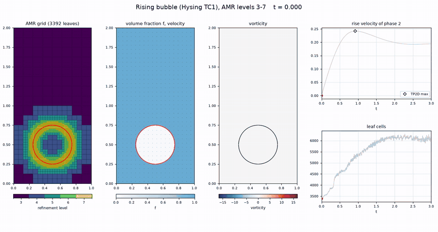
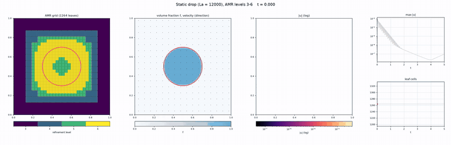
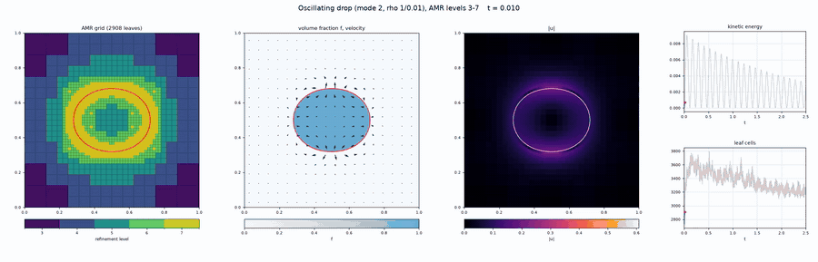
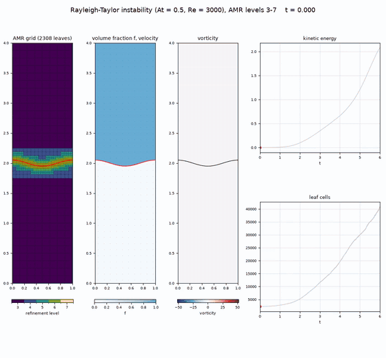
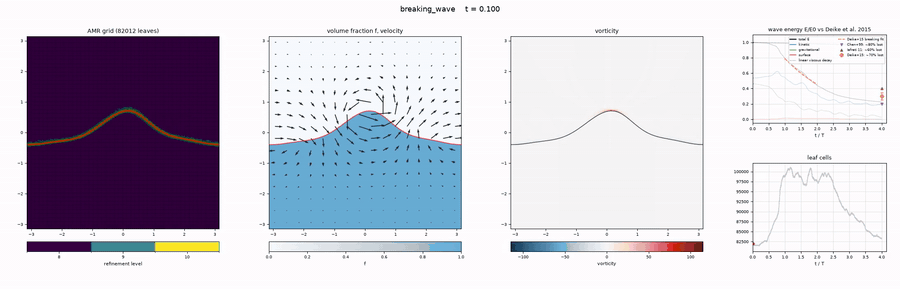

# vof2d — 2D two-phase flow with VOF and quadtree AMR

Incompressible two-phase Navier–Stokes solver in C++17 (no external libraries, optional
OpenMP, optional CUDA for the linear solves):

* **Interface**: geometric VOF — PLIC reconstruction with Mixed-Youngs-Centered normals,
  Weymouth & Yue (2010) conservative, bounded, directionally split advection.
  Volume is conserved to round-off (~1e-14) and 0 ≤ f ≤ 1 exactly.
* **Surface tension**: balanced-force CSF with height-function curvature
  (2nd-order, with parabola-fit fallbacks).
* **Flow**: collocated cell-centred velocity + face fluxes, BCG-type 2nd-order momentum
  advection, implicit viscosity, approximate projection (Basilisk-style), density ratios
  up to 1000+. Optional momentum-conserving advection (`conservingMomentum = true`):
  each phase's momentum is carried by the same geometric fluxes as the volume fraction,
  which prevents spurious kinetic-energy growth in violent high-density-ratio flows
  (on by default for `breaking_wave`). Optional MAC predictor (`macPredictor = true`):
  the momentum is advected with a time-centred, MAC-projected face velocity
  (Bell–Colella–Glaz / Basilisk style) instead of the face velocity of the previous
  projection — second order in time instead of first, for one extra Poisson solve
  per step (~1.9× cost). The VOF step always uses the exactly balanced face velocity of
  the last projection (keeps the balanced-force equilibrium of static interfaces).
* **Pressure**: flexible CG preconditioned by aggregation AMG (K-cycle); ~15–25
  iterations independent of mesh size and density ratio. With `make CUDA=1` the
  pressure and implicit-viscosity solves run on an NVIDIA GPU (see [GPU](#gpu-cuda)).
* **AMR**: cell-based quadtree, 2:1 balanced (incl. corners), O(1) neighbour lookup;
  memory and regrid cost grow with the number of cells, not with 4^maxLevel.
  The interface is always at the finest level with a buffer; elsewhere the mesh follows
  a wavelet estimate of the velocity. All operators are face-flux based, so they are
  conservative across resolution jumps.

## Build and test

```bash
make -j            # bin/vof2d
make check         # builds and runs all unit tests (~30 s)

make -j CUDA=1     # same, with the CUDA linear solver (needs nvcc, see below)
make CUDA=1 check  # also checks the GPU solver against the CPU one
```

## Run

```bash
./bin/vof2d cases/rising_bubble.cfg                     # Hysing TC1 at h = 1/128
./bin/vof2d cases/rising_bubble.cfg maxLevel=8 outDir=out/l8   # command-line overrides
OMP_NUM_THREADS=4 ./bin/vof2d cases/dam_break.cfg
```

Case defaults are applied first, then the config file, then `key=value` overrides.
Every key is documented in the `cases/*.cfg` files; `outDir/params.log` records the full
parameter set of a run and can itself be used as a config file.

Available cases: `rising_bubble`, `rising_bubble2` (Hysing et al. 2009 TC1/TC2),
`static_drop`, `oscillating_drop`, `rayleigh_taylor`, `dam_break`, `breaking_wave`,
`zalesak`, `single_vortex`.

Output in `outDir`:

| file | content |
|------|---------|
| `fields_*.vtu`, `fields.pvd` | leaf cells with f, u, v, p, rho, mu, kappa, level, vorticity (ParaView) |
| `interface_*.vtp`, `interface.pvd` | PLIC interface segments |
| `diagnostics.dat` | per-step volumes, centroids, phase velocities, kinetic energy, circularity |

Post-processing (numpy + matplotlib only):

```bash
python3 scripts/plot_field.py output/rising_bubble/fields_00030.vtu --field vorticity --edges
python3 scripts/plot_diagnostics.py output/rising_bubble/diagnostics.dat   # overlays Hysing reference
python3 scripts/make_video.py output/rising_bubble                          # MP4: grid + f + vorticity (needs ffmpeg)
python3 scripts/make_video.py output/static_drop --field3 speed --log --diag umax --diag-log --normalize-arrows
```

## Performance

* **Threads**: set `OMP_NUM_THREADS` to the number of physical cores (8 on a Ryzen 7
  7700X). Using all SMT threads is slower: the multigrid cycle runs thousands of short
  parallel regions per solve, and every barrier waits for the slowest thread.
* At the end of a run, `vof2d` prints the wall time per step of each phase and the
  linear-solver share, e.g.
  ```
  done: 40 steps, t = 0.00922951, wall 0.8 s (18.77 ms/step)
  time per step (ms):  advection 0.34  properties+curvature 0.67  momentum+viscosity 3.18  projection 12.84  regrid 1.46
    of which linear solves: 121 solves, setup 2.21, iterations 12.37
  ```
* Memory and regrid time follow the number of cells, so deep AMR is practical. Rising
  bubble, `minLevel=5`, regrid every step, 8 threads:

  | maxLevel | leaves | ms/step | peak memory |
  |---------:|-------:|--------:|------------:|
  | 11 | 57,164 | 34 | 83 MB |
  | 12 | 112,904 | 76 | 157 MB |
  | 13 | 224,456 | 156 | 300 MB |
  | 14 | 448,040 | 321 | 594 MB |

CPU time per step (Ryzen 7 7700X, 8 cores, WSL2, 40 steps) before and after the
OpenMP / memory work of this version (fixed thread teams, no per-step reallocation,
parallel setup and regrid, sparse mesh maps):

| run | leaves | before ms/step | now ms/step | speed-up |
|-----|-------:|---------------:|------------:|---------:|
| `rising_bubble.cfg minLevel=7 maxLevel=9` | 44,060 | 40.5 | 18.3 | 2.2× |
| `dam_break.cfg minLevel=8 maxLevel=10` | 72,448 | 58.3 | 32.9 | 1.8× |
| `rayleigh_taylor.cfg minLevel=7 maxLevel=9` | 72,460 | 72.9 | 38.6 | 1.9× |
| `breaking_wave.cfg minLevel=8 maxLevel=10` | 81,064 | 108.2 | 59.6 | 1.8× |
| `rising_bubble.cfg minLevel=9 maxLevel=11` | 569,252 | 456.8 | 264.1 | 1.7× |

Results are unchanged: on the default cases the meshes are identical step by step and
the diagnostics agree to the printed precision.

## GPU (CUDA)

`make CUDA=1` builds `bin/vof2d` with a CUDA backend for the elliptic solves (pressure
projection, MAC predictor, implicit viscosity), which take ~75 % of a time step on the CPU.
The rest of the step (VOF advection, curvature, momentum, AMR) stays on the CPU (OpenMP).

```bash
make clean && make -j CUDA=1                       # CUDA_HOME: from nvcc in PATH, else /usr/local/cuda
make -j CUDA=1 CUDA_HOME=$HOME/.local/cuda-12.9    # toolkit elsewhere
make -j CUDA=1 CUDA_ARCH=sm_86                     # default: native (the GPU of the build machine)
./bin/vof2d cases/rising_bubble.cfg maxLevel=10 minLevel=8              # GPU (default in CUDA builds)
./bin/vof2d cases/rising_bubble.cfg maxLevel=10 minLevel=8 gpu=false    # CPU only
```

* `gpu = true` is the default of CUDA builds; without a usable device, or in a CPU-only
  build, the run prints a warning and solves on the CPU. Systems with fewer than 120,000
  unknowns are always solved on the CPU (below ~150k unknowns the multithreaded CPU
  solver is faster; `poisson::Options::gpuMin`).
* The assembly and the AMG hierarchy are built on the host as for the CPU solver; the whole
  flexible-CG / K-cycle iteration runs in a single cooperative kernel (no per-operation
  launches or host round trips, which matters especially under WSL). Differences to the
  CPU solver: multicolour Gauss–Seidel smoothing, and aggregates of up to 8 cells (instead
  of 4) below the second level, which halves the number of latency-bound coarse-level
  visits of the K-cycle. Iteration counts stay within ~10 % of the CPU ones, and the
  solutions agree to the solver tolerance (`tests/test_poisson.cpp`).
* Only the toolkit's `nvcc` and the CUDA runtime (linked statically) are needed; the
  device code takes about a minute to compile.

Measured on an RTX 4060 Ti (WSL2), host part with `OMP_NUM_THREADS=4`, 40 steps. To show
where the GPU pays off, the GPU column sends every linear solve of ≥ 30,000 unknowns to
the device (`poisson::Options::gpuMin = 30000`; with the default of 120,000 the first four
runs solve on the CPU):

| run | leaves | CPU ms/step | GPU ms/step |
|-----|-------:|------------:|------------:|
| `rising_bubble.cfg minLevel=7 maxLevel=9` | 44,060 | 19.5 | 24.7 |
| `dam_break.cfg minLevel=8 maxLevel=10` | 72,448 | 36.4 | 41.7 |
| `rayleigh_taylor.cfg minLevel=7 maxLevel=9` | 72,460 | 39.6 | 45.8 |
| `breaking_wave.cfg minLevel=8 maxLevel=10` | 81,064 | 65.9 | 67.6 |
| `rising_bubble.cfg minLevel=8 maxLevel=10` (8 threads) | 153,548 | 57.9 | 55.1 |
| `dam_break.cfg minLevel=9 maxLevel=11` (8 threads) | 276,895 | 133.7 | 118.7 |
| `rising_bubble.cfg minLevel=9 maxLevel=11` | 569,252 | 281 | 198 |

With the multithreaded CPU solver the GPU only pays off above ~150k unknowns, hence the
120,000 default threshold. End to end, the host part (assembly, AMG setup, the rest of the
time step) limits the gain. The default cases (a few thousand leaves) run entirely on the
CPU.

## Gallery

Each animation shows, left to right: the AMR grid coloured by refinement level (red: PLIC
interface), the volume fraction with velocity arrows, a flow field, and time series.
Click an animation for the full-resolution MP4. The raw data (VTK files, diagnostics)
are not in the repository; the commands below regenerate them.

### Rising bubble (Hysing et al. 2009, test case 1)

[](docs/media/rising_bubble.mp4)

A light bubble (ρ 1000/100, μ 10/1, σ 24.5) rises and deforms into a skirted cap; the
interface band stays at level 7 while the wake and the side gaps refine with the flow
(3,400 → 6,200 leaves). Max rise velocity 0.2421 (ref. 0.2417), min circularity 0.9007
(ref. 0.9013), centroid y(3) = 1.0823 (ref. 1.0813).

```bash
./bin/vof2d cases/rising_bubble.cfg maxLevel=7 outputEvery=0.02 outDir=output/video_rising_bubble
python3 scripts/make_video.py output/video_rising_bubble
```

### Static drop (spurious currents)

[](docs/media/static_drop.mp4)

A drop at rest (La = 12000): the parasitic currents of the start-up transient decay from
8e-4 to ~2e-8 (log-scale speed in the third panel, arrow directions only). The grid does not
change because nothing moves.

```bash
./bin/vof2d cases/static_drop.cfg outputEvery=0.05 outDir=output/video_static_drop
python3 scripts/make_video.py output/video_static_drop --field3 speed --log --diag umax --diag-log --normalize-arrows
```

### Oscillating drop (capillary mode 2)

[](docs/media/oscillating_drop.mp4)

An elliptic drop (10 % deformation, density ratio 100) oscillates under surface tension; the
far-field grid refines and coarsens with every swing. Period 0.2350 vs 0.2306 (linear theory),
damping rate 0.209 vs ≈ 0.20.

```bash
./bin/vof2d cases/oscillating_drop.cfg outputEvery=0.01 outDir=output/video_oscillating_drop
python3 scripts/make_video.py output/video_oscillating_drop --field3 speed --diag ekin --fps 20
```

### Rayleigh–Taylor instability (At = 0.5, Re = 3000)

[](docs/media/rayleigh_taylor.mp4)

Heavy fluid falls into light fluid: mushroom, Kelvin–Helmholtz roll-ups, impact on the
bottom wall and mixing (t = 6). The finest-level band follows the stretching interface
(2,300 → 41,000 leaves) while the undisturbed fluid stays coarse.

```bash
./bin/vof2d cases/rayleigh_taylor.cfg tEnd=6 outputEvery=0.025 outDir=output/video_rayleigh_taylor
python3 scripts/make_video.py output/video_rayleigh_taylor --height 10 --dpi 100 --arrows 10 --diag ekin
```

### Breaking wave (Deike, Popinet & Melville 2015)

[](docs/media/breaking_wave.mp4)

A steep Stokes wave (ε = 0.55, Re = 40000, Bo = 1000, density ratio 850) overturns, plunges,
traps air and breaks up over 4 wave periods (levels 4–9, momentum-conserving advection).
The top-right panel compares the energy budget with the literature: 84 % of the wave energy
dissipated after 4 periods vs ≈ 70 % in Deike et al. (Chen et al. 1999: ≈ 80 %, Iafrati
2011: ≈ 60 %).

```bash
./bin/vof2d cases/breaking_wave.cfg outDir=output/breaking_wave_deike2015
python3 scripts/make_video.py output/breaking_wave_deike2015 --wave-energy --fps 20 --dpi 100 --arrows 16 --arrow-umax 1.0
```

At level 10 the breaking sheets fragment into droplets smaller than a cell, which the
surface-tension force can propel unphysically (one rose to the top wall at levels 4–10);
add `rejectUnresolvedCurvature=true` to such runs (see Validation and Limitations).

## Validation (results from this code)

Hysing et al. (2009) rising bubble, test case 1 (reference: TP2D):

| quantity | level 7, uTol=0.005 | level 8, uTol=0.002 (default) | reference |
|---|---|---|---|
| max rise velocity | 0.2414 @ t=0.934 | 0.2420 @ t=0.939 | 0.2417 @ t=0.921 |
| min circularity | 0.8995 @ t=2.01 | 0.9023 @ t=1.936 | 0.9013 @ t=1.904 |
| centroid y(t=3) | 1.0837 | 1.0829 | 1.0813 |
| leaves / wall time | 4.3k / 18 s | 10k / 85 s | |

AMR vs uniform at level 7: with `uTol=0.001` the AMR run gives y(3) = 1.0822 vs 1.0825 on a
uniform 128² mesh, with 4× fewer cells and 2.2× less wall time. Volume drift ~1e-12.

Test case 2 (level 8): rise-velocity maxima 0.2506 @ 0.735 and 0.2378 @ 2.00
(reference 0.2502 @ 0.732, 0.2393 @ 2.06), centroid y(3) = 1.130 (ref. ≈ 1.138).

Unit tests (`make check`):

* VOF single vortex (T = 8): L1 shape error 2.1e-3 (128²), 5.4e-4 (256²), order ≈ 2;
  mass error ≤ 5e-15; AMR result identical to uniform mesh.
* Height-function curvature: 2nd order for circles, ellipse, sine wave, wall-attached drops.
* Static drop with VOF + computed curvature: capillary number of spurious currents ~4e-5;
  with exact curvature the drop stays at rest to ~1e-11 (balanced force).
* Oscillating drop (mode 2, ε = 0.1, R/h = 25.6): period 0.2350 vs 0.2306 from linear
  theory, damping rate 0.209 vs ≈ 0.20.
* Breaking wave (Deike, Popinet & Melville, JFM 769, 2015: eps = 0.55, Re = 40000,
  Bo = 1000), energy dissipated after 4 periods and breaking-stage decay rate
  (t/T in [1, 2]) vs ≈70% and 0.22 in the paper (Chen et al. 1999 ≈80%, Iafrati 2011
  ≈60%):

  | levels | leaves | wall (8 cores) | dissipated | decay rate | airborne liquid |
  |---|---:|---:|---:|---:|---|
  | 4–9 (default) | 11k–22k | 11 min | 84% | 0.27 | none above the crest |
  | 4–10 | 20k–45k | 33 min | 77% | 0.25 | sub-cell fragment rises to the top wall |
  | 4–10, `rejectUnresolvedCurvature=true` | 20k–52k | 37 min | 83% | 0.27 | splash droplet to y = 0.94, falls back |
  | 8–10 | 81k–101k | 53 min | 77% | 0.23 | droplet to y = 1.08, falls back |

  Breaking starts at t/T ≈ 0.6 vs ≈ 1 in all runs. Multithreaded runs are not bitwise
  reproducible, and after breaking the flow is chaotic: the spread between repeated runs
  has not been measured, so differences of a few percent between these rows (e.g. 77% vs
  83% at levels 4–10) are not attributed to the settings. The paper used level 10 and a
  vortex sheet in the air at t = 0 (here: air at rest). `make_video.py --wave-energy`
  plots it.
* Hydrostatics, density ratio 1000 on AMR with regridding: |u| ≤ 1e-11.
* Taylor–Green vortex: 2nd order (uniform and AMR); lid-driven cavity Re=100 within
  0.005 of Ghia et al.
* Poisson/AMG: 2nd order on uniform meshes; iterations constant from 65k to 1M unknowns.
* MAC predictor (translating Taylor–Green, refined at fixed CFL): L2 order 1.6 vs 1.1
  with the lagged advection velocity, 3× (128²) to 5× (256²) more accurate; with the
  slope limiter switched off the orders are exactly 2.0 vs 1.0.

## Layout

```
src/mesh.*          quadtree AMR mesh, fields, faces, refine/coarsen, transfer
src/amr.*           refinement criterion (interface band + velocity wavelets)
src/plic.*, vof.*   PLIC geometry, reconstruction, advection, VOF prolongation
src/curvature.*     height-function curvature
src/poisson.*       AMG-preconditioned CG for -div(beta grad x) + lambda x = b
src/poisson_gpu.*   CUDA backend of the same solver (make CUDA=1)
src/navier_stokes.* momentum predictor, balanced-force projection, time-step control
src/io.*, cases.*   config, VTK output, diagnostics, test cases
src/simulation.*    initialization, time step sequence, run loop
docs/ARCHITECTURE.md  design notes and conventions
```

## Known limitations

* At coarse/fine faces the elliptic operator uses a symmetric two-point flux that
  ignores the tangential offset of the coarse cell centre; this is locally first order
  (the solver stays SPD and the interface is never at a resolution jump, so two-phase
  results are unaffected, but single-phase AMR errors are 2–4× those of the uniform
  mesh at the coarse resolution).
* Time integration of the viscous term is backward Euler (first order in time). Without
  `macPredictor` the momentum advection velocity is lagged (first order in time).
* Static drop, long times: once the spurious currents have decayed to ~1e-8, solver
  round-off seeds a slow drift of the whole drop (surface-tension force errors of the
  height-function curvature push a drop that is off its grid-symmetric position further),
  growing ~4× per unit time. With `poissonTol = 1e-13` the currents keep decaying to
  ~5e-10 by t = 7 before the drift starts. Irrelevant for flows that are not at rest.
* Contact lines: walls act as a 90° contact angle.
* For small meshes (< ~10^4 leaves) OpenMP brings little; use `OMP_NUM_THREADS=1..4`.
  Large loops are memory-bandwidth bound: on a dual-channel desktop, 4 → 8 threads gains
  only ~10–20 %.
* CUDA: only the linear solves run on the GPU, and only for systems of ≥ 120,000 unknowns.
* `maxLevel` ≤ 14 (index range of the mesh); memory is ~1.3–1.5 kB per leaf.
* Fragments smaller than about one cell (spray, micro-bubbles in breaking waves at level
  10) are not resolved: their curvature estimate is wrong (clamped at |κ| = 1/h, of either
  sign), so the surface-tension force can propel them, e.g. a droplet levitating instead
  of falling. `rejectUnresolvedCurvature = true` drops the force where the curvature
  exceeds 1/h, which removes the clamped values (the levitating droplet then falls) and
  leaves resolved interfaces unchanged; it is a partial remedy, since smaller wrong values
  on fragments of 0.4–1.5 cells remain. Off by default.
* Runs with more than one thread are not bitwise reproducible (the order in which OpenMP
  combines the threads' partial sums varies); single-threaded runs are.

## Figures

* `docs/images/rising_bubble_tc1.png` — TC1 diagnostics at h = 1/128 and 1/256 vs reference
* `docs/images/rising_bubble_v_t3.png` — vertical velocity and AMR mesh at t = 3
* `docs/images/rt_dambreak_zalesak.png` — Rayleigh–Taylor (t = 3.5), dam break (t = 0.25 s),
  Zalesak disk after one revolution
* `docs/images/breaking_wave_energy.png` — breaking wave after 4 periods: AMR grid, fields
  and the energy budget against Deike et al. (2015)

## Acknowledgements and references

This is an independent C++ implementation (no third-party source code), but its design
follows closely the methods of [Basilisk](http://basilisk.fr) and Gerris by Stéphane
Popinet: cell-based quadtree AMR with composite operators, collocated approximate
projection with balanced-force surface tension, height-function curvature, conservative
split VOF, momentum-conserving two-phase transport and wavelet-based adaptation.

**Adaptive solver framework**
- S. Popinet, Gerris: a tree-based adaptive solver for the incompressible Euler equations
  in complex geometries, *J. Comput. Phys.* 190 (2003) 572–600, [doi:10.1016/S0021-9991(03)00298-5](https://doi.org/10.1016/S0021-9991(03)00298-5).
- S. Popinet, An accurate adaptive solver for surface-tension-driven interfacial flows,
  *J. Comput. Phys.* 228 (2009) 5838–5866 (balanced force, height functions), [doi:10.1016/j.jcp.2009.04.042](https://doi.org/10.1016/j.jcp.2009.04.042).
- S. Popinet, A quadtree-adaptive multigrid solver for the Serre–Green–Naghdi equations,
  *J. Comput. Phys.* 302 (2015) 336–358 (Basilisk), [doi:10.1016/j.jcp.2015.09.009](https://doi.org/10.1016/j.jcp.2015.09.009).

**Volume of fluid**
- R. Scardovelli, S. Zaleski, Analytical relations connecting linear interfaces and volume
  fractions in rectangular grids, *J. Comput. Phys.* 164 (2000) 228–237, [doi:10.1006/jcph.2000.6567](https://doi.org/10.1006/jcph.2000.6567).
- E. Aulisa, S. Manservisi, R. Scardovelli, S. Zaleski, Interface reconstruction with
  least-squares fit and split advection in three-dimensional Cartesian geometry,
  *J. Comput. Phys.* 225 (2007) 2301–2319 (Mixed-Youngs-Centered normals), [doi:10.1016/j.jcp.2007.03.015](https://doi.org/10.1016/j.jcp.2007.03.015).
- G. D. Weymouth, D. K.-P. Yue, Conservative Volume-of-Fluid method for free-surface
  simulations on Cartesian-grids, *J. Comput. Phys.* 229 (2010) 2853–2865, [doi:10.1016/j.jcp.2009.12.018](https://doi.org/10.1016/j.jcp.2009.12.018).
- M. Rudman, A volume-tracking method for incompressible multifluid flows with large
  density variations, *Int. J. Numer. Meth. Fluids* 28 (1998) 357–378 (consistent momentum
  transport), [doi:10.1002/(SICI)1097-0363(19980815)28:2<357::AID-FLD750>3.0.CO;2-D](https://doi.org/10.1002/%28SICI%291097-0363%2819980815%2928%3A2%3C357%3A%3AAID-FLD750%3E3.0.CO%3B2-D).

**Surface tension and Navier–Stokes**
- J. U. Brackbill, D. B. Kothe, C. Zemach, A continuum method for modeling surface
  tension, *J. Comput. Phys.* 100 (1992) 335–354, [doi:10.1016/0021-9991(92)90240-Y](https://doi.org/10.1016/0021-9991(92)90240-Y).
- M. M. Francois et al., A balanced-force algorithm for continuous and sharp interfacial
  surface tension models within a volume tracking framework, *J. Comput. Phys.* 213 (2006)
  141–173, [doi:10.1016/j.jcp.2005.08.004](https://doi.org/10.1016/j.jcp.2005.08.004).
- J. B. Bell, P. Colella, H. M. Glaz, A second-order projection method for the
  incompressible Navier–Stokes equations, *J. Comput. Phys.* 85 (1989) 257–283, [doi:10.1016/0021-9991(89)90151-4](https://doi.org/10.1016/0021-9991(89)90151-4).

**Linear solver**
- Y. Notay, Flexible conjugate gradients, *SIAM J. Sci. Comput.* 22 (2000) 1444–1460, [doi:10.1137/S1064827599362314](https://doi.org/10.1137/S1064827599362314).
- Y. Notay, P. S. Vassilevski, Recursive Krylov-based multigrid cycles, *Numer. Linear
  Algebra Appl.* 15 (2008) 473–487 (K-cycle), [doi:10.1002/nla.542](https://doi.org/10.1002/nla.542).
- Y. Notay, An aggregation-based algebraic multigrid method, *Electron. Trans. Numer.
  Anal.* 37 (2010) 123–146, [ETNA](https://etna.math.kent.edu/vol.37.2010/pp123-146.dir/pp123-146.pdf).

**Test cases and reference data**
- S. Hysing et al., Quantitative benchmark computations of two-dimensional bubble
  dynamics, *Int. J. Numer. Meth. Fluids* 60 (2009) 1259–1288, [doi:10.1002/fld.1934](https://doi.org/10.1002/fld.1934) (`rising_bubble`, `rising_bubble2`).
- L. Deike, S. Popinet, W. K. Melville, Capillary effects on wave breaking, *J. Fluid
  Mech.* 769 (2015) 541–569, [doi:10.1017/jfm.2015.103](https://doi.org/10.1017/jfm.2015.103) (`breaking_wave`; energy dissipation data); H. Lamb,
  *Hydrodynamics*, 6th ed., Cambridge University Press (1932) (third-order Stokes wave,
  drop oscillations).
- G. Chen, C. Kharif, S. Zaleski, J. Li, Two-dimensional Navier–Stokes simulation of
  breaking waves, *Phys. Fluids* 11 (1999) 121–133, [doi:10.1063/1.869907](https://doi.org/10.1063/1.869907); A. Iafrati, Energy dissipation
  mechanisms in wave breaking processes: spilling and highly aerated plunging breaking
  events, *J. Geophys. Res.* 116 (2011) C07024, [doi:10.1029/2011JC007038](https://doi.org/10.1029/2011JC007038) (energy loss values quoted by Deike et al.).
- G. Tryggvason, Numerical simulations of the Rayleigh–Taylor instability, *J. Comput.
  Phys.* 75 (1988) 253–282, [doi:10.1016/0021-9991(88)90112-X](https://doi.org/10.1016/0021-9991(88)90112-X) (`rayleigh_taylor`).
- J. C. Martin, W. J. Moyce, Part IV. An experimental study of the collapse of liquid columns on a
  rigid horizontal plane, *Phil. Trans. R. Soc. Lond. A* 244 (1952) 312–324, [doi:10.1098/rsta.1952.0006](https://doi.org/10.1098/rsta.1952.0006) (`dam_break`).
- S. T. Zalesak, Fully multidimensional flux-corrected transport algorithms for fluids,
  *J. Comput. Phys.* 31 (1979) 335–362, [doi:10.1016/0021-9991(79)90051-2](https://doi.org/10.1016/0021-9991(79)90051-2) (`zalesak`); W. J. Rider, D. B. Kothe,
  Reconstructing volume tracking, *J. Comput. Phys.* 141 (1998) 112–152, [doi:10.1006/jcph.1998.5906](https://doi.org/10.1006/jcph.1998.5906) (`single_vortex`).
- U. Ghia, K. N. Ghia, C. T. Shin, High-Re solutions for incompressible flow using the
  Navier–Stokes equations and a multigrid method, *J. Comput. Phys.* 48 (1982) 387–411, [doi:10.1016/0021-9991(82)90058-4](https://doi.org/10.1016/0021-9991(82)90058-4)
  (lid-driven cavity test).

## License

MIT — see [LICENSE](LICENSE).
